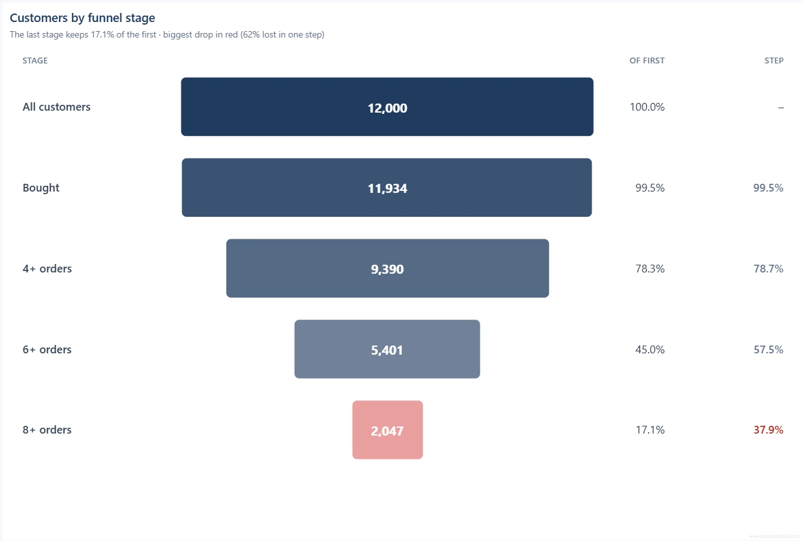
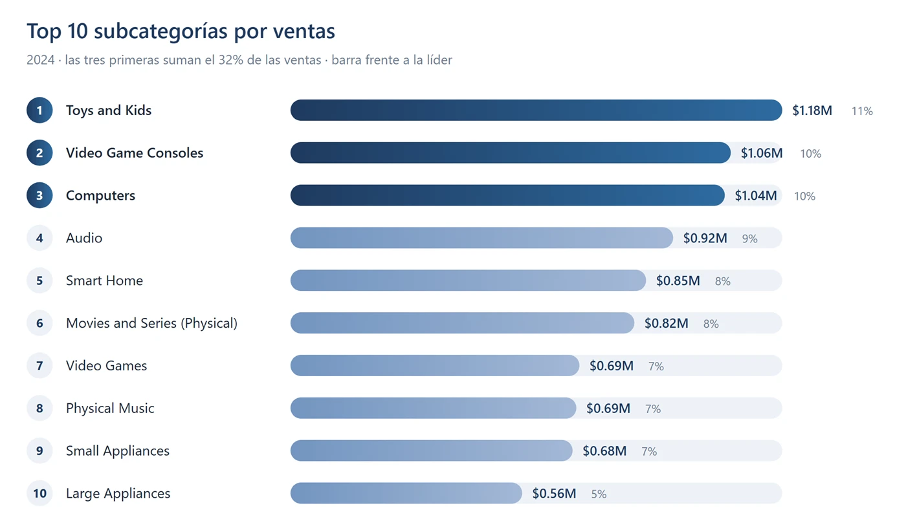

<a href="https://csalcedodatabi.com">
  <picture>
    <source media="(prefers-color-scheme: dark)" srcset="profile/banner-dark.svg">
    
  </picture>
</a>

**Business Intelligence · Power BI · Deneb / Vega · Microsoft Fabric**

Ayudo a equipos de datos a convertir modelos de Power BI y Microsoft Fabric en algo que
la gente **usa de verdad**: visualizaciones que responden preguntas, plantillas que se
copian y pegan, y automatización que quita el trabajo manual de en medio.

  
  
  
  
  
  
  

<!-- actividad:start -->

<b>41</b> <a href="https://csalcedodatabi.com/blog">artículos en el blog</a> · <b>38</b> plantillas Deneb · <b>21</b> repos públicos · <b>6330</b> commits en 12 meses

<!-- actividad:end -->

## Lo que hago, en imágenes

**Explorador de KPIs por categoría** — un tablero entero escrito en Deneb: eliges el año y la
métrica, y las seis tarjetas se recalculan con su tendencia.

**Mapa de calor de calendario** — 53 semanas × 7 días a partir de UNA columna de fecha.
**Ranking bump chart** — cómo se mueve el top 6 mes a mes.

Todas las plantillas Deneb, con su código Vega-Lite (JSON) listo para copiar, en
[csalcedodatabi.com/deneb](https://csalcedodatabi.com/deneb).

### Nuevo: visuales HTML Content

**Embudo de clientes** — hecho con el visual HTML Content: una medida DAX que devuelve HTML y CSS, con el PBIP de
ejemplo para abrir en Power BI Desktop. En [la galería](https://csalcedodatabi.com/recursos/galeria-html/)
y en [PowerBI-HTML](https://github.com/CSalcedoDataBI/PowerBI-HTML).

### Nuevo: visuales SVG con DAX

**Ranking en barras** — una medida DAX que devuelve una imagen SVG, sin visuales
personalizados. Cuatro visuales (ranking, pendiente anual, pictograma y estrellas) en
[la galería SVG](https://csalcedodatabi.com/recursos/galeria-svg/) y en
[PowerBI-SVG](https://github.com/CSalcedoDataBI/PowerBI-SVG).

## Referencias para agentes de IA

Cuando un agente escribe DAX, M o un spec de Deneb, inventa nombres de funciones y
propiedades. Las referencias `*-for-agents` salen del propio motor o de los esquemas
oficiales, así que el agente consulta lo que existe de verdad. Se instalan como plugins de
Claude Code; [dax-for-agents](https://github.com/CSalcedoDataBI/dax-for-agents) y
[ubl-star](https://github.com/CSalcedoDataBI/ubl-star) ya están en el directorio de plugins
de Anthropic.

| Lenguaje | Referencia |
|---|---|
| DAX | [dax-for-agents](https://github.com/CSalcedoDataBI/dax-for-agents) |
| Power Query M | [powerquery-m-for-agents](https://github.com/CSalcedoDataBI/powerquery-m-for-agents) |
| Vega / Vega-Lite (Deneb) | [vega-for-agents](https://github.com/CSalcedoDataBI/vega-for-agents) |
| TMDL | [tmdl-for-agents](https://github.com/CSalcedoDataBI/tmdl-for-agents) |
| Python · pandas | [pandas-for-agents](https://github.com/CSalcedoDataBI/pandas-for-agents) |
| Python · Polars | [polars-for-agents](https://github.com/CSalcedoDataBI/polars-for-agents) |
| PySpark y Spark SQL | [spark-for-agents](https://github.com/CSalcedoDataBI/spark-for-agents) |
| T-SQL (Fabric) | [tsql-for-agents](https://github.com/CSalcedoDataBI/tsql-for-agents) |

## Lo que construyo

<!-- repos:start -->
**Galerías de visuales para Power BI**

- [PowerBI-Deneb](https://github.com/CSalcedoDataBI/PowerBI-Deneb) — Plantillas Deneb (Vega-Lite) listas para copiar en tus informes. · ★ 13
- [PowerBI-HTML](https://github.com/CSalcedoDataBI/PowerBI-HTML) — Plantillas HTML Content: medidas DAX que devuelven HTML, con su PBIP de ejemplo.
- [PowerBI-SVG](https://github.com/CSalcedoDataBI/PowerBI-SVG) — Visuales SVG con DAX: medidas que dibujan rankings, pendientes y pictogramas.

**Referencias para agentes de IA — plugins de Claude Code**

- [dax-for-agents](https://github.com/CSalcedoDataBI/dax-for-agents) — Cada función DAX con su firma, dónde es válida y las trampas que la doc no cuenta. · ★ 3
- [powerquery-m-for-agents](https://github.com/CSalcedoDataBI/powerquery-m-for-agents) — Cada función de Power Query M, exportada del propio motor. · ★ 4
- [vega-for-agents](https://github.com/CSalcedoDataBI/vega-for-agents) — Vega y Vega-Lite desde sus esquemas oficiales: Deneb sin propiedades inventadas.
- [tmdl-for-agents](https://github.com/CSalcedoDataBI/tmdl-for-agents) — TMDL para escribir modelos semánticos como código (pre-release).
- [tsql-for-agents](https://github.com/CSalcedoDataBI/tsql-for-agents) — T-SQL probado contra Fabric Warehouse y el SQL endpoint (pre-release).
- [spark-for-agents](https://github.com/CSalcedoDataBI/spark-for-agents) — PySpark y Spark SQL con disponibilidad en Fabric (pre-release).
- [pandas-for-agents](https://github.com/CSalcedoDataBI/pandas-for-agents) — pandas por versión, con deprecaciones (pre-release).
- [polars-for-agents](https://github.com/CSalcedoDataBI/polars-for-agents) — Polars por versión (pre-release).

**Microsoft Fabric y agentes de datos**

- [fabric-data-agents](https://github.com/CSalcedoDataBI/fabric-data-agents) — Cómo construir e instruir un Fabric Data Agent, medido y reproducible. · ★ 2
- [fabric-app-gallery](https://github.com/CSalcedoDataBI/fabric-app-gallery) — Plantillas de Microsoft Fabric Apps listas para ejecutar y adaptar.

**Herramientas y automatización**

- [agentic-board](https://github.com/CSalcedoDataBI/agentic-board) — Coordinador de agentes de código sobre un board real de GitHub Projects. · ★ 3
- [ubl-star](https://github.com/CSalcedoDataBI/ubl-star) — Factura electrónica UBL 2.1 a esquema estrella para Power BI: CLI y plugin. · ★ 2
- [powerbi-pbip-tools](https://github.com/CSalcedoDataBI/powerbi-pbip-tools) — Automatización de proyectos Power BI en formato PBIP. · ★ 6

**Datos y retos**

- [SampleDataSets](https://github.com/CSalcedoDataBI/SampleDataSets) — Conjuntos de datos de muestra para pruebas, aprendizaje y demos. · ★ 4
- [BI_Challenges](https://github.com/CSalcedoDataBI/BI_Challenges) — Soluciones a retos de la comunidad BI en PySpark, Python y M. · ★ 1

<!-- repos:end -->

## Publicado recientemente

### En el blog

<!-- blog:start -->
- [pandas, Polars, Spark y T-SQL para agentes de IA](https://csalcedodatabi.com/blog/pandas-polars-spark-tsql-for-agents/) — 5 nov 2026
- [ubl-star: la factura electrónica es el XML, no el PDF](https://csalcedodatabi.com/blog/ubl-star/) — 5 nov 2026
- [Power Query M para agentes: powerquery-m-for-agents](https://csalcedodatabi.com/blog/powerquery-m-for-agents/) — 5 nov 2026
- [vega-for-agents: Vega y Vega-Lite sin nombres inventados](https://csalcedodatabi.com/blog/vega-for-agents/) — 5 nov 2026
- [Formato de fechas en Power BI: grupos de cálculo y Deneb](https://csalcedodatabi.com/blog/formato-fechas-grupos-calculo-deneb/) — 23 sep 2026
<!-- blog:end -->

Todo en [csalcedodatabi.com/blog](https://csalcedodatabi.com/blog)

### Plantillas nuevas en la galería

<!-- plantillas:start -->
- [tools](https://github.com/CSalcedoDataBI/PowerBI-Deneb/tree/main/tools) — 27 nov 2026
- [Tendencia IBCS Ano Anterior](https://github.com/CSalcedoDataBI/PowerBI-Deneb/tree/main/Tendencia_IBCS_Ano_Anterior) — 10 nov 2026
- [Momentum Medias Moviles](https://github.com/CSalcedoDataBI/PowerBI-Deneb/tree/main/Momentum_Medias_Moviles) — 10 nov 2026
- [Mapa Mundial Ventas Pais](https://github.com/CSalcedoDataBI/PowerBI-Deneb/tree/main/Mapa_Mundial_Ventas_Pais) — 10 nov 2026
- [Benchmark Ventas Por Pais](https://github.com/CSalcedoDataBI/PowerBI-Deneb/tree/main/Benchmark_Ventas_Por_Pais) — 10 nov 2026
<!-- plantillas:end -->

Todas en [la galería](https://csalcedodatabi.com/deneb)

### Últimas versiones de las herramientas

<!-- releases:start -->
- [tmdl-for-agents v0.1.0](https://github.com/CSalcedoDataBI/tmdl-for-agents/releases/tag/v0.1.0) — 19 nov 2026
- [dax-for-agents v0.9.1](https://github.com/CSalcedoDataBI/dax-for-agents/releases/tag/v0.9.1) — 14 nov 2026
- [dax-for-agents v0.9.0](https://github.com/CSalcedoDataBI/dax-for-agents/releases/tag/v0.9.0) — 13 nov 2026
- [vega-for-agents v0.2.0](https://github.com/CSalcedoDataBI/vega-for-agents/releases/tag/v0.2.0) — 4 nov 2026
- [vega-for-agents v0.1.0](https://github.com/CSalcedoDataBI/vega-for-agents/releases/tag/v0.1.0) — 2 nov 2026
<!-- releases:end -->

## Cómo se mantiene esto

La línea de actividad y las tres listas de arriba las genera
[`profile/scripts/update_profile.py`](profile/scripts/update_profile.py) una vez por semana,
leyendo el RSS del sitio y la API de GitHub. Sin servicios de terceros: nada de este perfil
depende de un dominio que no sea mío. Todo lo que escribe es **texto**, no imágenes: un SVG
con texto dentro se encoge con la columna y en un móvil queda ilegible, además de invisible
para un lector de pantalla.

Este repositorio además mide el tráfico de los repos públicos de la cuenta — el detalle del
sistema de telemetría está en [`telemetry/`](telemetry/) y el histórico graficado en
[`docs/`](docs/).

## Hablemos

Estoy abierto a colaboraciones y proyectos de BI, Power BI, Deneb/Vega y Microsoft Fabric.

- [LinkedIn](https://www.linkedin.com/in/cristobal-salcedo)
- [contacto@csalcedodatabi.com](mailto:contacto@csalcedodatabi.com)

## Licencia

[MIT](LICENSE) — puedes usar, copiar y adaptar el contenido de este repositorio citando la autoría.
